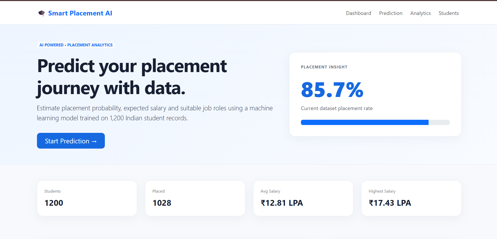
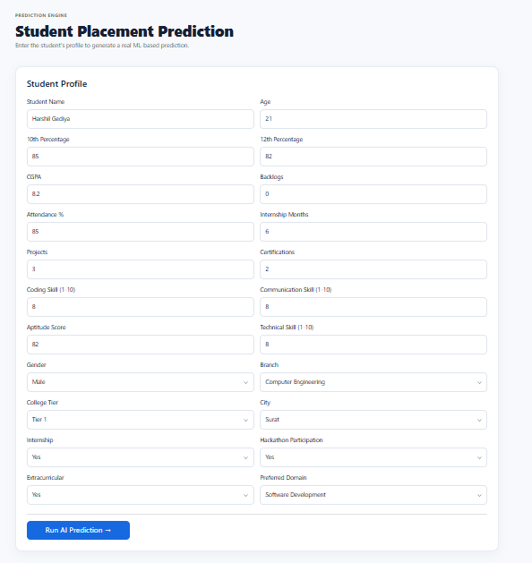
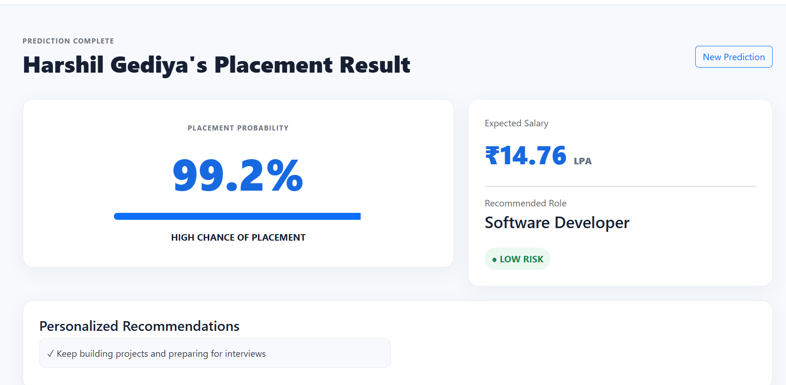
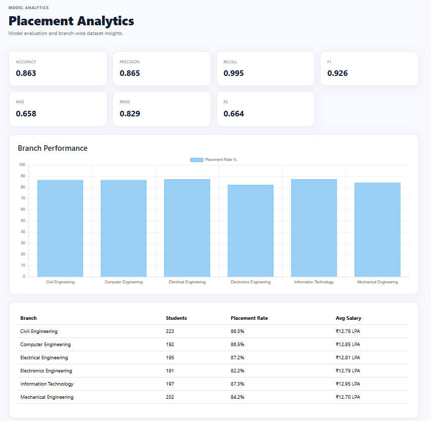
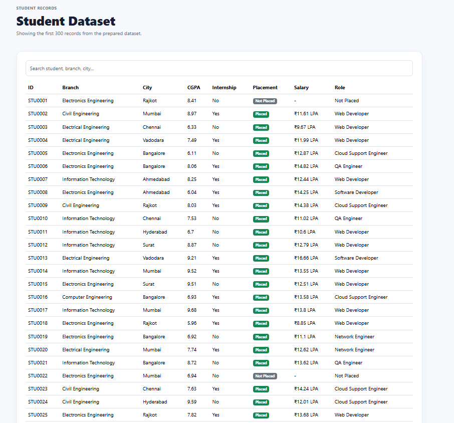

# 🎓 Smart Placement AI

An end-to-end Machine Learning web application designed to evaluate student profiles and predict campus placement probability, expected salary package, recommended career roles, and personalized improvement areas.

---

## 🌟 Key Features & Visual Walkthrough

### 1. 📊 Interactive Dashboard & Placement Insights
- **Dataset Overview**: Real-time aggregate statistics of total students, overall placement rate, average salary package, and highest package.
- **Visual Progress Tracking**: Dynamic placement rate progress indicator and key placement metrics summary.
- **Transparent Workflow**: 3-step visual workflow explanation tailored for Indian engineering colleges.

---

### 2. 🤖 AI-Powered Student Profile Prediction Engine
- **Comprehensive Academic Inputs**: Evaluates 10th percentage, 12th percentage, college CGPA, backlogs, and attendance records.
- **Hands-on Experience & Achievements**: Factors in internship duration (months), live academic projects, and professional certifications.
- **Skill Proficiency Assessments**: Granular 1-10 scoring for Coding, Communication, Aptitude, and Technical competencies.
- **Contextual Demographics**: Incorporates college tier (Tier 1/2/3), engineering branch, metropolitan city, hackathons, and preferred domains.

---

### 3. 🎯 Instant Prediction Results & Career Guidance
- **Placement Probability Gauge**: Precise likelihood estimation using Random Forest classification.
- **Expected Salary (LPA)**: Regression-predicted compensation package in INR Lakhs Per Annum.
- **Smart Job Role Recommendation**: Suggests optimal career paths (e.g., *Software Developer*, *Data Analyst*, *Cloud Support Engineer*, *QA Engineer*, *Network Engineer*, *Web Developer*) mapped to skill strengths.
- **Risk Level Assessment**: Categorizes student placement confidence into **LOW**, **MEDIUM**, or **HIGH** risk.
- **Personalized Actionable Recommendations**: Generates profile-tailored improvement tips to enhance employability before interview rounds.

---

### 4. 📈 Model Performance Analytics & Branch Breakdown
- **Robust ML Evaluation Metrics**: Direct model evaluation dashboard displaying Accuracy, Precision, Recall, F1 Score, MAE, RMSE, and R² score.
- **Interactive Chart.js Visualizations**: Visual comparison of placement percentages across different engineering disciplines (Computer, IT, Electrical, Mechanical, Civil, Electronics).
- **Tabular Branch Comparison**: In-depth analysis of student strength, success rates, and average compensation per department.

---

### 5. 🔍 Student Dataset Explorer with Real-Time Search
- **Instant Client-Side Filtering**: Live reactive search across student IDs, departments, and cities.
- **Detailed Student Records**: Transparent browsing of 300+ sample student profiles including CGPA, internship status, placement outcomes, and placed roles.
- **Status Badging**: Clean visual indicators distinguishing placed candidates from candidates seeking opportunities.

---

## ⚡ Feature Summary Highlights

| Category | Feature Capability |
| :--- | :--- |
| **🧠 Classification** | Random Forest Classifier predicting placement probability (%) |
| **💰 Regression** | Random Forest Regressor predicting expected salary in ₹ LPA |
| **💼 Role Matching** | Intelligent rule-based domain and skill-matrix role mapping |
| **🛡️ Risk Profiling** | Instant risk categorization (Low / Medium / High Risk) |
| **💡 Career Advice** | Automated diagnostic recommendations for resume & skill strengthening |
| **📊 Analytics Engine** | Comprehensive performance metrics and interactive Chart.js graphs |
| **🔎 Data Exploration** | Fast, responsive client-side dataset search and filtering |
| **🎨 User Experience** | Clean, responsive Bootstrap 5 interface built for smooth navigation |
